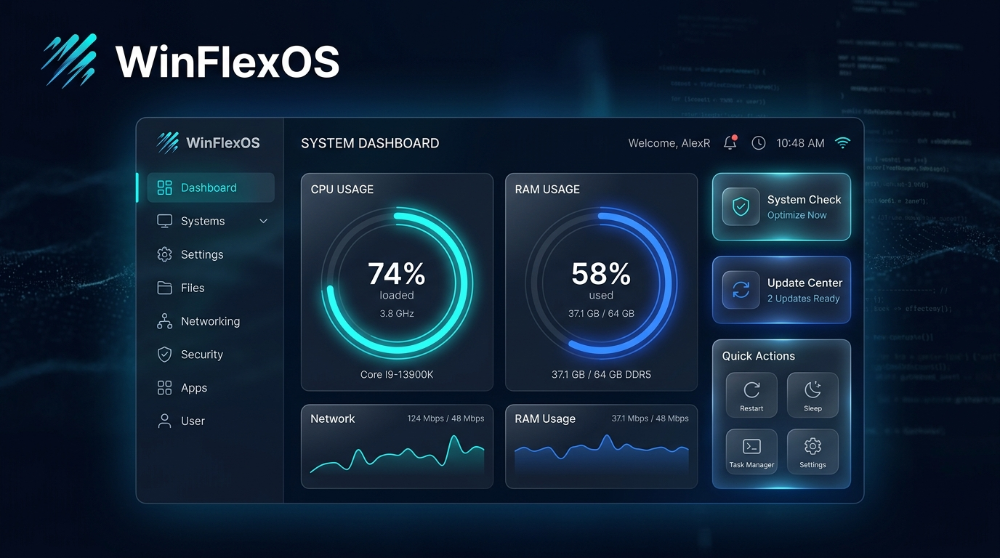

# 🚀 WinFlexMenu

<p align="center">
  
</p>

**WinFlexMenu** is the ultimate high-performance management and optimization interface for **WinFlexOS**. Built in PowerShell with a modern WPF hardware-accelerated UI, it provides a seamless, ultra-fast way to control, optimize, and customize your Windows system.

---

## ✨ Key Features

* **⚡ Ultra-Fast & Non-Blocking:** Instant sub-second startup, background asynchronous execution for zero UI freezing, and parallel delta sync.
* **🛠 Complete Maintenance & Repair:** One-click deep cleaning, RAM garbage collection, icon & font cache repair, WSUS/Windows Update reset.
* **🛡 Security & Diagnostics:** Real-time hardware health (CPU, RAM, SMART, Battery), network diagnostic tools, Windows Defender & Firewall management.
* **🎨 35+ Dynamic Themes:** Instant switching between Dark, Light, Cyberpunk, Tokyo Night, Retro, and custom image themes.
* **🤖 AI & Prompt Studio:** Built-in NanoBanana studio and instant access to 100+ top AI platforms.
* **🌐 Dual-Language Support:** Full dynamic localization in both Hebrew (עברית) and English.

---

## 🛠 Quick Installation & Launch

Run **WinFlexMenu** directly from PowerShell. Open an elevated PowerShell session (Run as Administrator) and execute:

```powershell
irm https://raw.githubusercontent.com/dor2500/winFlexMenu/main/WinFlexMenu.ps1 | iex
```
