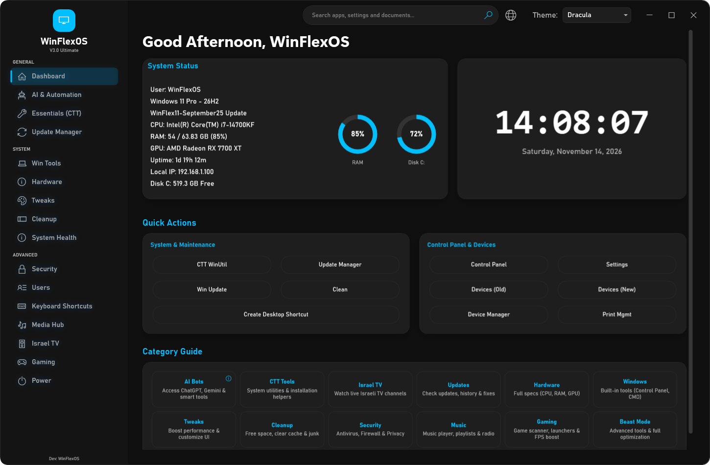
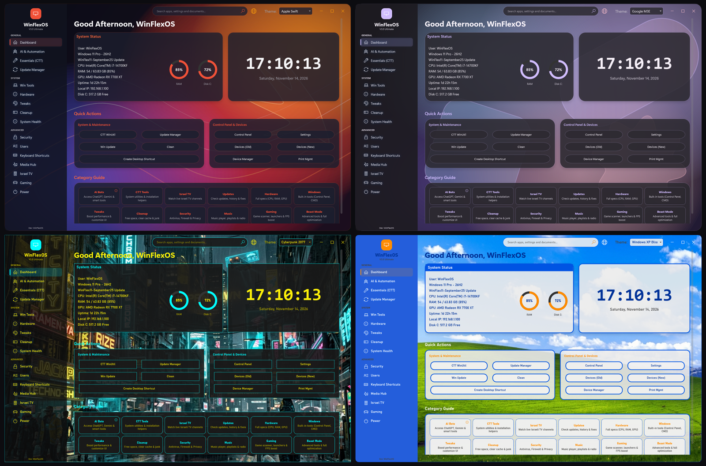
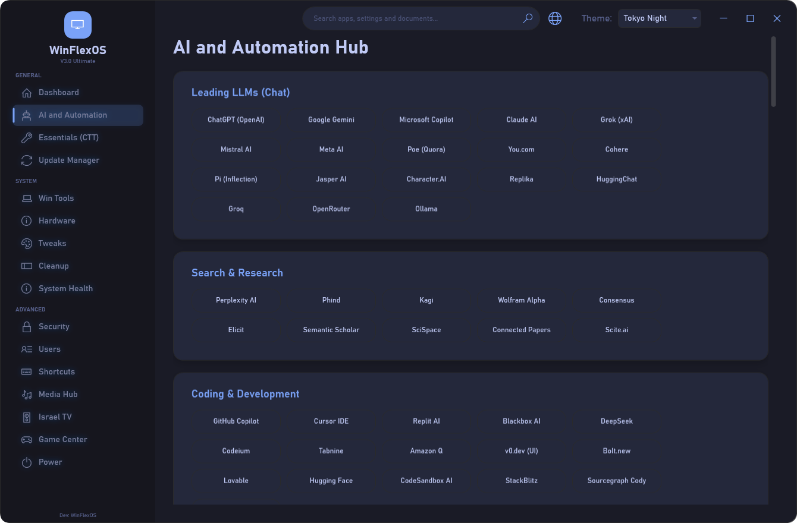

# 🚀 WinFlexMenu

<p align="center">
  
</p>

**WinFlexMenu** is the ultimate high-performance management and optimization interface for **WinFlexOS**. Built in PowerShell with a modern WPF hardware-accelerated UI, it provides a seamless, ultra-fast way to control, optimize, and customize your Windows system.

---

## ✨ Key Features (V3.2)

* **⚡ Ultra-Fast & Non-Blocking:** Instant sub-second startup, asynchronous background hardware/update scans for zero UI freezing, and parallel delta sync.
* **📦 Winget Quick App Installer Hub:** One-click installation for essentials including 7-Zip, VLC, Chrome, Firefox, Notepad++, VS Code, Discord, Everything, PowerToys, Git, Python 3, and ShareX — plus Winget "Upgrade All Apps".
* **🛠 Deep Maintenance & Windows Tools:** Multi-profile Chromium cache cleaning (Edge, Chrome, Brave) & Firefox, DISM image repair, Services, Task Scheduler, Firewall & Defender status checks, Windows Sandbox, SmartScreen, and automated Office ODT removal/installation.
* **🎮 Gaming Center & Live Israel TV / Radio:** Auto-detects Steam, Epic, GOG, Ubisoft, Xbox & custom games with launch, folder access, and NVIDIA App/GFE support, plus built-in WebView2 player for Live Israeli TV (Kan 11, Keshet 12, Reshet 13, Now 14, i24NEWS, Knesset) & Radio (Galgalatz, Kan 88, Kan Bet, 103FM, Eco 99FM).
* **🛡 Hardware Telemetry & Power Timers:** Real-time CPU, RAM, SMART, Battery, and OS/Network diagnostics, Windows 11/System tweaks (End Task on taskbar, Sticky Keys, Restart Explorer), and Scheduled Shutdown Timers (30m, 1h, 2h, Custom).
* **🎨 Dynamic Themes & AI Prompt Studio:** 42+ themes including Apple Swift, Google M3E, Dracula, Pitch Black, Glass Aero, Cyber Noir, Tokyo Night, Retro XP/Wii, plus a refreshed AI Hub, built-in NanoBanana prompt generator (Hebrew/English + Copy), and Gemini direct prompt.
* **🌐 Dual-Language Support:** Full dynamic RTL/LTR localization in both Hebrew (עברית) and English.

---

## 📸 Interface Showcase

### 🖥️ Main Dashboard (English & Hebrew RTL)
<p align="center">
  
  
</p>

### 🎨 42 Dynamic Themes (Apple Swift, Google M3E, Gaming, Retro & Art)
<p align="center">
  
</p>

### 🛡️ System Health Center & 🤖 AI Hub
<p align="center">
  
  
</p>

---

## 🛠 Quick Installation & Launch

Run **WinFlexMenu** directly from PowerShell. Open an elevated PowerShell session (Run as Administrator) and execute:

```powershell
irm https://raw.githubusercontent.com/dor2500/winFlexMenu/main/WinFlexMenu.ps1 | iex
```
